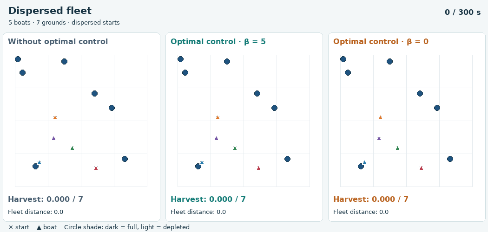

# Somethin’ Fishy: fishing fleet optimal control

How much more can a fleet catch if it plans when to leave a ground and where to fish next? On a map with five boats and seven units of fish, the fleet harvested **6.908 units with optimal control** in 300 seconds, compared with **3.000 without optimal control**. Both fleets started in the same places and followed the same movement and fishing equations.



**Explore:** [Interactive gallery](results/gallery.html) (open locally for playback, speed controls and scrubbing) · [Catch, travel and stock curves](results/baseline_300_outcomes.png) · [Interactive blue-boat steering explainer](audit/movement_explained.html) · [Model and optimality conditions](MODEL.md) · [Project notebook](fishing_optimal_control.ipynb).

## What the comparison measures

- **Without optimal control:** Each boat gives every ground equal attraction and uses full throttle. Once per second, it computes a steering target from the grounds’ distances and remaining stocks. It does not plan ahead or coordinate with the other boats.
- **With optimal control:** A Pontryagin forward–backward solver chooses a target and throttle schedule for each boat. It minimizes fish left at the deadline, travel cost, and an optional penalty for boats being close together.
- **Crowding:** Both optimal-control columns use the same solver. Setting β = 0 removes the proximity penalty; it does not turn off optimal control. The reported catch is measured in fish units for every column, regardless of the objective weights.

Each ground starts with one fish unit. Gain is the absolute increase in catch over the unplanned fleet at the same deadline, using β = 5. Each map name opens its animation; the plots show cumulative harvest, total distance traveled, and fish remaining by ground.

| Map | Deadline | Without optimal control | Optimal · β = 5 | Gain | Optimal · β = 0 | Plots |
| --- | ---: | ---: | ---: | ---: | ---: | --- |
| [5 boats, 7 grounds](results/baseline_300.gif) | 300 s | 3.000 | 6.908 | +3.908 | 6.909 | [Outcomes](results/baseline_300_outcomes.png) |
| [5 boats, 10 grounds](results/grounds_300.gif) | 300 s | 4.000 | 9.825 | +5.825 | 9.830 | [Outcomes](results/grounds_300_outcomes.png) |
| [8 boats, 12 grounds](results/fleet_300.gif) | 300 s | 5.000 | 11.889 | +6.889 | 11.901 | [Outcomes](results/fleet_300_outcomes.png) |
| [5 boats on a harbor line, 7 grounds](results/harbor_300.gif) | 300 s | 2.000 | 6.440 | +4.440 | 6.443 | [Outcomes](results/harbor_300_outcomes.png) |
| [5 boats, 7 grounds](results/dispersed_400.gif) | 400 s | 3.000 | 6.991 | +3.991 | 6.992 | [Outcomes](results/dispersed_400_outcomes.png) |
| [5 boats, 7 grounds](results/dispersed_600.gif) | 600 s | 3.000 | 6.999 | +3.999 | — | [Outcomes](results/dispersed_600_outcomes.png) |

The 600-second scenario includes one optimized schedule (β = 5). The dispersed runs at 300, 400 and 600 seconds use the same geometry but solve for different deadlines. The harbor scenario starts at five distinct points along a line. Final positions are free in every case.

[Unrounded results](results/summary.json) include the catch, distance, solver residual and Hamiltonian gap. The [policy files](results/policies) contain the executable schedules and their replay checks. The numerical checks support these particular policies; they do not prove a global optimum or predict a catch increase for every possible fleet.

## Run locally

From the repository root, with Python 3.9–3.12:

```sh
python -m venv .venv
source .venv/bin/activate
python -m pip install -r requirements.txt
python -m unittest discover -s model
python model/figures.py
```

The figure command runs the unplanned fleets, replays the saved optimized schedules, and builds the GIFs, plots, summary and offline gallery. It does not need to run a new optimization. To fit a policy from a coverage assignment and run its dense numerical checks:

```sh
python model/pontryagin_controller.py --horizon 400 --seed coverage --name my_fleet
python model/finalize_pmp.py results/policies/my_fleet.npz my_fleet_checked --horizon 400
```

Fitting is substantially slower than replay. Inspect the resulting convergence flag and residuals before interpreting a fitted policy.

Project team: Sam Layton, Xander de la Bruere, Jakob Gertsch, Matt Mella, and Wilson Stoddard.
