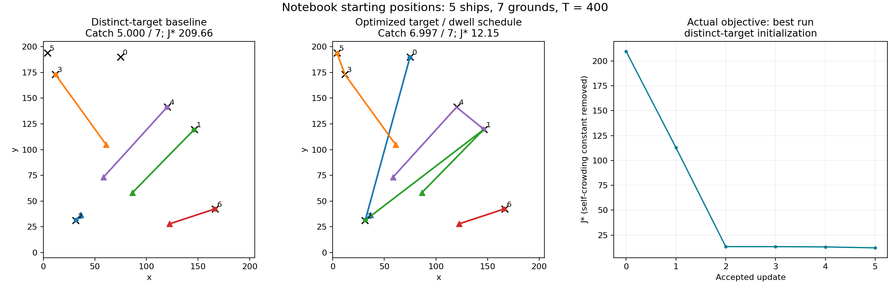

# Fishing optimal-control audit

Audit date: 2026-10-23. Original repository revision: `23043fe5525d3b27dc0401f733fc8a9ec169ca26`.

## Current result: Pontryagin solver with explicit regularization and feedback execution

The active solver is again based on forward states, backward costates, and joint Hamiltonian control updates. The route/timing optimizer is retained as a separate benchmark. **The original raw-attraction, fixed-open-loop sweep has not been made reliably convergent without changes.** The repaired solver uses equivalent heading coordinates, an explicit regularized feedback control family, and a small smooth approximation to travel cost. Its numerical convergence claims apply to that regularized problem, not the full unmodified open-loop problem.

### Verified 400-unit results

All rows use the original five-boat/seven-ground notebook geometry, dispersed starts, original weights, stock law, attraction bounds `[0,10]`, speed bound `[0,1]`, and free terminal positions. The objective column evaluates **the original travel cost**, not its smooth approximation; the constant self-pair cost is excluded as before.

| Controller / initialization | Harvest / 7 | Original-cost J* | Numerical result |
|---|---:|---:|---|
| Original displayed code | 3.981605 | See historical audit | Original run reproduced |
| Retained route/timing benchmark | 6.997157 | 12.154187 | Validated feasible benchmark |
| PMP, unoptimized coverage initialization | 6.991280 | 12.053427 | Regularized residual tolerances met |
| PMP, benchmark-initialized continuation, refined grid | 6.997296 | 9.605551 | Regularized residual tolerances met |

The best PMP policy reduces the benchmark's original cost by approximately **21.0%**, with essentially the same harvest. Crowding falls from 5.093865 to 4.264958; travel cost falls from 6.776002 to 5.070205. Every boat moves: distances are approximately 165.224, 106.204, 66.326, 43.410, and 125.857. No movement bonus, mandatory visit bonus, altered reward weight, or return-home condition was added.

The best result uses the benchmark as an initialization, followed by adjoint/Hamiltonian optimization and time-grid refinement. It is not an independent cold start. The separate coverage run uses an unoptimized distinct-ground assignment with two additional visits and a simple dwell guess; it never calls the route optimizer. That initialization already covers seven grounds. Local optimal control should not be credited with discovering that coverage from an all-ones guess. Different local minima remain possible.

Final validated artifacts are in `audit/results/pontryagin/`; `best_400.json` and `coverage_400_verified.json` contain tolerances, initialization, replay errors, and explicit scope flags. `audit/results/working/` remains the benchmark. `audit/results/pmp/` contains exploratory attempts, including failed ones; files there are not automatically validated final solutions.

### Verified 600-unit notebook result

The longer notebook also passes the declared regularized-PMP checks, starting from the unoptimized coverage guess and continuing with adjoint/Hamiltonian updates and a 200-to-400 interval refinement. Its original-cost `J*=13.089726`, versus the retained benchmark's `13.515531` (a 3.15% reduction); harvest is `6.998955 / 7`. All five boats move. No route-optimizer solution initializes this run.

The final projected residual is `0.000998902` and the integrated searched Hamiltonian gap is `0.00481610` over 1,200 samples, with maximum sampled gap `0.0000918865`. These pass the same `0.001` and `0.005` tolerances, but are close to their thresholds. The inner optimizer reached its iteration limit; coordinate polishing and the separate residual checks determine acceptance. This is weaker numerical stationarity than the best 400-unit result, not evidence of identical accuracy or a global optimum.

Feedback replay through the original equations has maximum position errors `2.42e-8` and `4.41e-10` at the two tested settings, fish error below `5.2e-13`, and original-cost error below `1.8e-11`. Minimum ground-center clearance is `0.3013`; reconstructed attractions and speeds satisfy the original bounds. The saved result is `audit/results/pontryagin/coverage_600_verified.json` with its matching `.npz` policy. Earlier 600-unit checkpoints that fail residual tests remain labeled as such.

### What remained wrong after the algebra fixes

The historical sign, Jacobian, time-alignment, speed-column, and stale-output bugs below remain genuine fixes. Three additional numerical issues mattered:

1. **Scale and cancellation.** A common positive scaling of all attractions has no effect on the paper's normalized heading. Optimizing redundant raw magnitudes makes the problem poorly conditioned. The notebook's additive denominator floor also converts very small Gaussian strengths into an unintended throttle. In addition, large opposing attractions can cancel to a tiny net vector. Reconstructing the desired heading from the best-conditioned pair of ground rays avoids gratuitous cancellation.
2. **A stopped boat hides its heading from a gradient update.** At zero speed, changing the heading has zero first derivative because the boat still does not move. A poor heading can also make the speed derivative say “stay stopped.” This is a coordinate trap, despite accurate derivatives. The solver now maximizes the Hamiltonian jointly, replaces an inactive target without changing the path, and then updates speed. It also tests full joint updates on large-gap intervals. In a tested benchmark-initialized run, this reduced the continuous Hamiltonian gap from about 0.368 to well below 0.001; merely iterating the gradient had not done so.
3. **Raw open-loop execution remains fragile.** Small errors in a frozen raw-attraction table can be amplified by the normalized field. One final-policy test drifted by 71.6 units at `rtol=1e-8`; tighter integration still drifted by 4.67 units. Those are failed checks, not accepted results. The executable controller therefore recomputes raw attractions and speed from the current positions and stocks. Its feedback replay through the original physical equations succeeds. A sampled `U_tensor` is for display and must not be reused as a fixed open-loop command table.

### Exactly what changes mathematically

**Heading coordinates are an algebraic reparameterization.** Away from a ground center, write

\[
\theta_{ij}=\frac{u_{ij}g_{ij}F_j/\rho_{ij}}
 {\sum_l u_{il}g_{il}F_l/\rho_{il}},\qquad
z_i=\sum_j\theta_{ij}f_j.
\]

Then \(s_i=A_i(z_i-x_i)\) for a positive scalar \(A_i\), and the original heading is \((z_i-x_i)/\|z_i-x_i\|\). Thus the effective target lies in the convex hull of the grounds. Conversely, choose
\(u_{ij}=c_i\theta_{ij}\rho_{ij}/(g_{ij}F_j)\), scaling the common positive \(c_i\) to keep every attraction at or below 10. Positive stocks and Gaussians make this possible. Gaussian vision and fish stocks still determine the raw attraction values; their disappearance from the reduced heading is a consequence of normalization, not a new physical assumption.

**The controller family is regularized.** With \(q_i=z_i-x_i\), \(R_i=\sqrt{\|q_i\|^2+\eta^2}\), and \(0\le a_i\le1\), use

\[
\dot x_i=a_iV\frac{q_i}{R_i},\qquad \eta=0.5.
\]

The actual speed supplied to the original equations is
\(v_i=a_iV\|q_i\|/R_i\). It never exceeds the original limit. This smooths the zero effective-target vector and slows motion only near that target. At target distance 5, the speed factor is about 0.995; at distance 0.5 it is about 0.707. This is an explicit **restriction/regularization of the controller family**, not an assertion that the unregularized control optimization is identical. The final paths can nevertheless be executed through the original movement and depletion equations by recomputing admissible raw `u` and `v` from the current state. Tested paths stay away from every ground-center singularity; the best refined run's minimum clearance is 0.0938.

**Travel cost is smoothed near zero speed.** The optimizer uses

\[
L_{\rm travel,\nu}=\gamma\sum_i
\left(\sqrt{v_i^2+\nu^2}-\nu\right),\qquad \nu=0.001,
\]

instead of \(\gamma\sum_i v_i\). This is a genuine, explicitly bounded objective change. For every policy,

\[
0\le J_{\rm original}-J_\nu\le\gamma NT\nu,
\]

which is 0.02 at `T=400` and 0.03 at `T=600`. The best refined run has `J_nu=9.593900` and original-cost `J*=9.605551`. The benchmark improvement is much larger than this smoothing allowance. Fish depletion, crowding, all original weights, starting positions for each reported scenario, and terminal conditions are unchanged.

These choices are supported by the experiments; they are not a proof that every other unregularized numerical method must fail. Holding the best coarse policy fixed while changing `eta` from 0.1 to 1 changed original cost by less than 0.006 and harvest by less than 0.00006. Those are policy-sensitivity checks, not separate reoptimized optima.

### The forward–backward mathematics and numerical method

Use log stock \(\ell_j=\log(F_j/F_0)\), so
\(\dot\ell_j=-r\sum_i C_{ij}\) and \(F_j>0\). In the reparameterized feedback equations, motion is independent of stock. Therefore the maximum-Hamiltonian terminal conditions are
\(p_x(T)=0\), \(p_{\ell_j}(T)=-\delta F_j(T)\), and \(p_{\ell_j}\) is constant. This is the adjoint of the transformed feedback system. It must **not** be mixed with the raw-open-loop adjoint below, whose stock-to-motion coupling is different.

The state Jacobian of the regularized motion is

\[
D_x\dot x_i=-a_iV\left(\frac I{R_i}-\frac{q_iq_i^T}{R_i^3}\right).
\]

The continuous position costate uses \(\dot p_x=L_x-(D_x\dot x)^Tp_x\), together with the fish contribution \(2r\sigma\sum_jp_{\ell_j}C_{ij}(f_j-x_i)\). Both the crowding and smoothed-travel gradients are included.

For a fixed heading, let \(k=p_x^Te\) and \(v_{\max}=V\|q\|/R\). Maximizing the speed-dependent Hamiltonian gives zero speed for \(k\le0\), the cap for \(k\ge\gamma\), and
\(\min(v_{\max},\nu k/\sqrt{\gamma^2-k^2})\) in between. The original bang-bang threshold is recovered as the travel smoothing tends to zero. Target maximization searches every hull edge, including endpoints and refined local maxima. Extending a target ray to the far hull edge cannot reduce its optimized instantaneous Hamiltonian, so edge targets represent the continuous maximization; finite-interval reparameterizations are still re-evaluated rather than presumed cost-identical.

Forward motion on each constant-control interval is solved analytically in radial coordinates. Define

\[
M_\eta(r)=\sqrt{r^2+\eta^2}+
\eta\log\frac{r}{\sqrt{r^2+\eta^2}+\eta}.
\]

Then \(M_\eta(r_{\rm end})=M_\eta(r_{\rm start})-aV\Delta t\). A stable log-radius solve avoids the singular normalized-field ODE integration. Ten-point Gaussian quadrature evaluates fish exposure and running costs. The backward pass differentiates that same forward map and quadrature, so its gradient matches the objective actually evaluated. Constrained adjoint-gradient updates, bounded Newton polishing, joint Hamiltonian updates, and objective acceptance replace the old squared-cross-product surrogate and fixed relaxation.

### What was verified, and what was not

- All **37 regression tests** pass. Both notebooks execute through their active controller and plotting cells in fresh headless namespaces using their saved, validated coverage-initialized policies. The resulting plots were inspected. Playback is explicitly distinguished from the more expensive `RECOMPUTE=True` optimization; a fresh optimization must pass its reported residual checks before being called converged.
- Directional finite differences check the full backward gradient, including motion, speed, fish depletion, crowding, and travel. Additional checks cover the radial flow Jacobian, exact endpoint behavior under time-grid refinement, original attraction reconstruction, and the zero-speed heading trap.
- An independent DOP853 solve checks the continuous regularized system. A separate DOP853 solve executes the feedback controller through `fishing.stable_rhs`, the **original physical equations**, at `(rtol,max_step)=(1e-8,0.5)` and `(1e-10,0.25)`.
- For the refined best run, original-equation feedback position errors are below `1.3e-8` and `5e-11`; stock errors are below `6e-14`. Original-cost evaluations agree to approximately `3e-11` or better. Attraction and speed bounds, positive stocks, and ground-center clearance are checked.
- The continuous adjoint and Hamiltonian are checked separately from the discrete gradient. The best run's integrated searched Hamiltonian gap is `0.000201` over 1,200 time samples; its maximum sampled gap is `0.0000469`. The projected control-coordinate residual is `0.0000603`. The declared tolerances are `0.005` integrated gap and `0.001` projected residual. These are numerical checks, not a global-optimality proof.
- Refining from 200 to 400 control intervals changes original cost from `9.605798` to `9.605551`, about `0.000247`. The final bounded-Newton call reached its function-evaluation budget; the independent declared residual tests nevertheless pass. Optimizer termination and numerical acceptance are recorded separately.
- The unmodified raw-open-loop PMP problem is **not** certified as converged. Shared-harbor PMP optimization has not been validated in this repair; the independently validated shared-harbor route benchmark remains available. The 400-unit results above use the notebook's dispersed starts, not the paper's common harbor.

### Running and inspecting the repair

The executable feedback controller and solver are in `pontryagin_controller.py`; the regularized equations and adjoints are in `regularized_pmp.py`; hull-edge polishing is in `pmp_edge.py`. The notebooks explicitly identify saved playback versus recomputation and identify the initialization. Raw attraction plots are display samples, not the executable policy.

```sh
python audit/pontryagin_controller.py --seed coverage --name coverage_400
python audit/edge_refine_pmp.py audit/results/pontryagin/coverage_400.npz coverage_400_refined
python audit/finalize_pmp.py audit/results/pontryagin/coverage_400_refined.npz coverage_400_verified --initialization "Coverage initialization followed by PMP refinement"
python audit/pontryagin_visuals.py audit/results/pontryagin/best_400.npz
python -m unittest discover -s audit -v
```

No LSODA or interrupted native integration is used. Python integration callbacks have deadlines, optimizer loops have explicit limits, and plots use a headless backend. A run that reaches a budget without meeting the residual tests reports that fact instead of claiming convergence.

---

## Retained route benchmark (previous active controller)

Before the PMP repair above, both notebooks used the following direct-control benchmark. It remains available separately. Its corrected-but-unsuccessful source is retained as an inactive historical cell, and its saved results remain available for comparison.

| Verified working run | Catch / 7 | J* | Search status |
|---|---:|---:|---|
| Original dispersed starts, T=400 | 6.997157 | 12.154187 | No improving tested route/dwell change |
| Original dispersed starts, T=600 | 6.999704 | 13.515531 | No improving tested route/dwell change |
| Paper's shared harbor, T=400 | 6.979712 | 20924.683325 | No improving tested route/dwell change |

The original displayed 400-unit run caught 3.981605; the first failed repair caught 2.002662. The working 400-unit controller moves all five boats and harvests all seven grounds. Its objective decreases from a feasible distinct-ground baseline of 209.659645 to 12.154187. This is an improved, validated feasible controller, not a proof of a global optimum or convergence of Pontryagin's necessary conditions.

Two substantive changes were necessary and are explicit:

1. **Restore the written dynamics.** `fishing.stable_rhs` evaluates `v*s/||s||` using log-scaled positive attraction weights. A common positive scale cancels from the normalized heading, so very small Gaussian weights no longer become an unintended throttle. This removes the notebook's additive `1e-10` floors from the working dynamics; it matches the paper away from its singularities. A stationary boat has zero velocity. A moving boat with zero or exactly cancelling attraction is rejected, not silently slowed. Generated controls avoid those cases and all ground centers.
2. **Replace the failed numerical search.** `working_controller.optimize` searches a restricted feasible family: one or two selected grounds per boat, full-speed travel, and optimized first-stop dwell time. Attraction is one-hot with magnitude 1, inside the original [0,10] bounds; speed is either 0 or V. These controls follow the paper's direction law. No arbitrary steering, new objective terms, mandatory movement, new fish dynamics, or tuned reward weights are introduced. This is a direct control-parameterization method, not the originally attempted forward-backward algorithm.

The search uses two initializations (distinct-ground assignment and nearest-ground), all single/pair ground choices, dwell proposals at 0, 20, 50, 100, 180, 280 and T, then bounded continuous dwell refinement. Defaults are six maximum coordinate passes, L-BFGS-B `ftol=1e-12`, `gtol=1e-6`, and 150 refinement iterations. The reported cases stopped after two or three passes without a tested improving change; continuous refinements reported success. Finite search coverage is not a global certificate.

The stopping offset is 0.5 spatial units, an admissible speed-switch choice, not a smoothing term in the equations. Reoptimizing with offsets 0.25, 0.5 and 1.0 gave catches 6.997333, 6.997157 and 6.996353, and objectives 12.149304, 12.154187 and 12.212900. The smaller offset gives negligible benefit while approaching the center singularity more closely; 0.5 is retained. The actual minimum distance to *any* center is checked analytically along every straight segment, including incidental passes by other grounds.

Validation uses DOP853 on the full coupled state plus crowding/travel integrals, split at every actual control change. The runs use `(rtol,max_step)=(1e-7,2)` and `(1e-9,0.5)`, `atol=rtol*1e-3`, and a 40-second callback deadline. On the 400-unit dispersed case the objective agrees with the analytic evaluator to less than 8e-11; final fish errors are below 3e-13. Shared-harbor objective errors are approximately 0.000234 and 0.00000365 (relative errors below 1.2e-8), resolving its sharp initial crowding contribution. Separate adaptive quadrature also agrees. Finite nonnegative monotone stocks, bounds, and position agreement are checked. A short-control-interval sampling bug found during sensitivity testing was fixed and given a regression test. All **23 regression checks** pass; both notebooks also execute end to end in a fresh headless namespace, including plots.

The original parameter values, maps, horizon and formal endpoint conditions are preserved. The main comparison keeps the notebook's dispersed starts; the additional shared-harbor run honors `x_i(0)=h` from the paper. The background mentions return-home, but the mathematical formulation explicitly leaves terminal positions free. Return-home remains a separately labeled extension rather than being silently added to this result.

Reproduce with `python audit/run_notebook.py` or `python audit/working_controller.py --scenario all`. New validated results, executable control schedules, and figures are in `audit/results/working/`; `python audit/controller_visuals.py` regenerates the original/working animation. The old `*_repair.json`, `*_controls.npz` and `comparison/` assets describe the failed first repair. They are retained as historical evidence, not the recommended result.

## Historical finding: original code and first repair

The failed improvement was not evidence that the fishing idea or Pontryagin's principle was wrong. The implementation did not solve the necessary conditions of its stated objective. Several errors independently invalidate its optimization update. There is also a singularity/conditioning problem in the forward model that remains important after fixing the algebra.

The priority of the first repair was the existing code. Both notebooks received corrected adjoints, time alignment, speed updates, Hamiltonian updates, fresh objective evaluation, and acceptance checks. That attempt preserved the numerical floors in their forward dynamics. It is superseded by the working controller described above; the following sections retain the evidence explaining why it was insufficient.

The notebooks' initial control guess is changed to a nearest-ground approach followed by stopping short of the center. This is an algorithmic initialization change within the existing admissible controls. With the original always-moving initialization, the corrected backward solver fails numerically near singular trajectory regions. With the nonsingular initialization and final integration repairs, each notebook accepts one update, then stops with an explicit numerical failure status. **The unrestricted sweep is still not reliably convergent.** Fixing the bugs does not by itself make this poorly conditioned formulation robust.

| Final repaired notebook run | Numerical initial J* | Numerical accepted J* | Accepted catch / 7 | Stop reason |
|---|---:|---:|---:|---|
| 400 time units | 7514.350232 | 594.601039 | 2.002662 | Next adjoint reaches the 20-second limit |
| 600 time units | 85606.409804 | 523.729454 | 3.000000 | Next adjoint requires steps smaller than floating-point spacing |

These are numerical rollout results at `rtol=1e-6`, `atol=1e-8`, not precision-independent certificates. A tighter DOP853 replay of the accepted 400-unit control also hit its 20-second limit. Those controls and the failure status are saved, but **their apparent objective decreases must not be confused with the stronger, successfully replayed continuous-model schedule results below**. The 400-unit update also sacrifices catch to reduce crowding, as the weighted objective permits. Earlier looser-tolerance runs gave materially different costs, which motivated tighter integration and exact control-switch splitting.

I reproduced the original saved catch of **3.981605146181011** exactly. Replaying its one control update produced **3.985957641486136**, not a substantial improvement. The saved number was printed before replaying the updated control. The other notebook's saved output repeats **3.996283504635416** for six iterations, then records an interruption. These are observations from the original code/output, not conjectures about the optimization landscape.

The strongest verified improvement uses a restricted set of controls that satisfies the original continuous equations: select a ground, travel, stop to fish, optionally visit another ground. On the original 400-unit map it collects **6.997157 of 7** stock units, compared with **5.000000** for a reasonable distinct-ground baseline, while reducing the actual objective after subtracting its constant self-pair term from **209.659645 to 12.154187**. This is a feasible improvement and a useful benchmark. It is not a proof of global optimality or convergence of the unrestricted forward-backward method.

## Scope and acceptance criteria

Sources examined: the supplied PDF and pasted LaTeX; the repository README and report notebook; the executable notebooks in `random/`; and their saved outputs. The report notebook contains no executable solver cells. The supplied PDF has unfinished Solution/Conclusion sections, so the executable notebooks are essential evidence. Document comments were treated as source material, not as instructions to perform unrelated work.

Acceptance criteria for this audit were:

1. Identify errors against the stated objective, not merely against existing code.
2. Reproduce a reported result and evaluate the controls that actually generated it.
3. Check corrected derivatives against numerical derivatives, including an end-to-end objective sensitivity check.
4. Demonstrate improvement using the original admissible steering and speed controls, unchanged fish depletion, and unchanged objective weights.
5. Check the improved schedules with numerical quadrature and full coupled ODE replay, rather than trusting their optimization evaluator alone.
6. Keep changes to the mathematical problem explicit and separate from code repairs.

All original-scenario experiments retain `alpha=.005`, `sigma=.05`, `r=.05`, `beta=5`, `gamma=.01`, `delta=100`, `epsilon=.0001`, `F0=1`, `V=1`, five ships, seven grounds, and seed 42. Attraction controls lie in `[0,10]`, as in the notebook. The paper does not fully specify their admissible set; this bound is taken from the implementation. Experiments use the original dispersed starting positions and, separately, the stated shared harbor `(100,0)`.

## What went wrong in the code

Cell numbers below are zero-based indices in the original notebooks.

| Location | Error | Consequence / repair |
|---|---|---|
| Cell 19, `solve_costate_equations` | Integrates from `T` to `0`, but samples the forward state at `T-t` | The first backward step uses the initial ship positions instead of terminal positions. Use dense `state_sol.sol(t)` and the same control lookup as the forward solve. |
| Cell 19, time integration | Adaptive steps can straddle discontinuous control changes; `t_eval` does not force internal steps | Split both integrations at the exact midpoint switching times implied by the original nearest-node control lookup. A tighter replay exposed material crowding-cost errors before this repair. |
| Cell 17 / paper adjoint | Fish contribution has the wrong sign and lacks `F_j` | The costate does not describe the marginal value of moving toward fish. Restore both. |
| Cell 15 / paper `Dxs` | Uses `alpha` instead of `2*alpha` | Incorrect derivative of the Gaussian. |
| Cell 17 / paper movement term | Multiplies the projection and position Jacobian in the wrong order | Adjoint propagation needs a transposed state Jacobian. Matrix products generally do not commute. |
| Cell 16 / paper fish costate | Omits the dependence of ship motion on fish stocks | `F_j` changes attraction and thus future motion as well as depletion. Restore the coupling term. |
| Cell 17 | Pairwise distances use `axis=1` instead of the coordinate axis, and the ship-difference sign is reversed | The calculated crowding gradient is not the derivative of the pairwise crowding cost. |
| Cell 23 | Minimizes the squared unnormalized cross product of `p` and `s` | This can shrink attractions to zero, or align them opposite to the costate. Neither implies a Hamiltonian maximum. Replace it with actual Hamiltonian maximization over bounded attraction controls. |
| Cell 23 | `+ gamma` in the speed switch | A positive travel penalty can incorrectly encourage movement. Use the negative travel contribution. |
| Cell 23 / cell 25 | Speed update is commented out; the commented assignment and speed plot use column `-2` | Dynamics read speed from `-1`; `-2` is the inactive harbor column. Apply and plot column `-1`. |
| Cell 23 | A speed-specific bounds list is defined but not passed to `minimize` | The old minimizer receives `[0,10]` for every column. The repair optimizes only attraction weights and sets speed in `[0,V]` separately. |
| Cell 23 | Fixed regularization strength 100 penalizes differences from the previously modified time row | Optimizes a different surrogate without measuring the real objective. Replace this with an objective-based acceptance/backtracking step. |
| Cell 23 | Prints catch and plots the forward solve before the new controls have been simulated | The displayed result belongs to the previous control. Re-simulate and report the accepted control. |
| `updated_sam_fishin`, cell 23 | `range(1)` | One update is not a convergence experiment. Use a bounded iteration loop and state why it stops. |
| `igofishing`, cell 23 | Skips ship zero; `lambda_reg` has no active definition | Leaves a ship uncontrolled and relies on hidden notebook state. Both are removed. |
| Cell 24 / cells 26 onward | Accidental speech appended to Python; old solver signatures and mixed `F0` values | A clean run is not reproducible. Remove the accidental text and preserve incompatible historical experiments as inactive notes. |
| Plotting | Divides final stocks by the largest final stock | Colors are not fractions of initial capacity. Use `F_j(T)/F0`. |

The original helper functions are not an alternative trusted implementation: several were explicitly marked outdated. Their incorrect costate computations are consolidated into the active `costate` function. No original source history is lost: Git retains it, and `diagnostics.py` explicitly loads the pinned pre-repair revision for reproduction.

## Correct mathematics for the original continuous model

Keep the report's maximum-Hamiltonian convention:

\[
H=p^T f-L,\qquad \dot p=-H_y,\qquad p(T)=-\phi_y.
\]

Thus **the original terminal conditions are correct** for free terminal positions:
\(p_i(T)=0\) and \(p_{F_j}(T)=-\delta\). The negative fish terminal costate is not a bug. This convention is consistent with [Liberzon's terminal-cost derivation](https://liberzon.csl.illinois.edu/teaching/cvoc/node82.html).

Let

\[
q_{ij}=f_j-x_i,\quad \rho_{ij}=\|q_{ij}\|,\quad
n_i=s_i/\|s_i\|,\quad Q_i=I-n_i n_i^T,\quad
C_{ij}=e^{-\sigma\rho_{ij}^2},\quad v_i=u_{i,K+1}.
\]

Away from the undefined points \(\rho_{ij}=0\) and \(s_i=0\),

\[
B_i:=D_{x_i}s_i=
\sum_j\frac{u_{ij}g_{ij}F_j}{\rho_{ij}}
\left[\left(2\alpha+\frac1{\rho_{ij}^2}\right)q_{ij}q_{ij}^T-I\right].
\]

The corrected adjoints are

\[
\dot p_i=
4\beta\sum_l\frac{x_l-x_i}{(\varepsilon+\|x_l-x_i\|^2)^2}
+2r\sigma\sum_j p_{F_j}F_j C_{ij}q_{ij}
-\frac{v_i}{\|s_i\|}B_i^T Q_i p_i,
\]

\[
\dot p_{F_j}=
rp_{F_j}\sum_i C_{ij}
-\sum_i\frac{v_i u_{ij}g_{ij}}{\|s_i\|}\,d_{ij}^T Q_i p_i.
\]

The speed-dependent Hamiltonian is \(v_i(p_i^Tn_i-\gamma)\). Therefore

\[
v_i=\begin{cases}
V,&p_i^Tn_i>\gamma,\\
0,&p_i^Tn_i<\gamma,
\end{cases}
\]

with any admissible speed maximizing this instantaneous expression at equality. Setting a derivative equal to zero does not itself produce the bang-bang rule: maximization over the bounded interval does.

The attraction derivative is

\[
H_{u_{ij}}=\frac{v_i g_{ij}F_j}{\|s_i\|}\,p_i^T Q_i d_{ij}.
\]

This vanishes at a differentiable **interior** optimum. At a lower bound, a maximum may have a negative derivative; at an upper bound it may have a positive derivative. A zero residual also cannot distinguish alignment from anti-alignment. Pontryagin's condition is a Hamiltonian maximum over the admissible controls, not merely stationarity; see [the maximization condition](https://liberzon.csl.illinois.edu/teaching/cvoc/node75.html).

For example, `p=(1,0)` and `s=(-1,0)` give zero cross product while moving opposite the beneficial direction. Multiplying every attraction by `c>0` leaves the original heading unchanged but multiplies the squared unnormalized residual by `c^2`. The old optimizer could report progress simply by making its inputs smaller.

The original continuous-model equations and an exact pointwise 2D Hamiltonian maximizer are implemented in `fishing.py`. The latter uses the cone generated by ground directions; at most two ground directions are needed to represent a feasible heading. It does not make a long-horizon forward-backward iteration globally convergent.

## Why the repaired notebook adjoint includes additional terms

The notebook implements

\[
d_{ij}=q_{ij}/(\rho_{ij}+e),\qquad
\dot x_i=v_i s_i/(\|s_i\|+e),\qquad e=10^{-10}.
\]

Consequently \(\|\dot x_i\|\ne v_i\). The travel penalty depends on positions, fish stocks, and attraction weights through the normalization. Ignoring that derivative would leave a code bug even after repairing the paper's formulas.

For \(\eta=\|s\|>0\), define

\[
M=\frac{I}{\eta+e}-\frac{ss^T}{\eta(\eta+e)^2},\qquad
H_s=v\left(Mp-\frac{\gamma e}{(\eta+e)^2}\frac{s}{\eta}\right).
\]

Use \(-D_xs^T H_s\) in the position adjoint and \(-\sum_i u_{ij}g_{ij}d_{ij}^T H_{s_i}\) in the fish adjoint. The implemented `Dxs` also differentiates `rho+e`, rather than silently using the derivative of `rho`. The notebook's speed switch is based on
\(p^Tw-\gamma\|w\|\), with \(w=s/(\eta+e)\). These are consistency repairs for existing equations, not new ecological assumptions.

At exactly zero attraction the arclength contribution is nondifferentiable. The repair uses a zero subgradient there and does not claim a smooth PMP certificate at that point. Ground-center behavior and tiny boundary layers also limit high-accuracy simulation of this formulation.

## Verified improvement under the original continuous equations

The experiment controls are deliberately simple: one nonzero attraction weight equal to 1; speed either 1 or 0; at most two grounds per ship. A ship stops 0.5 distance units before a ground's center, avoiding the undefined unit direction. The fishing kernel's characteristic radius is \(1/\sqrt{.05}\approx4.47\), so this stopping point retains about 98.76% of peak fishing intensity. A positive standoff restricts our candidate policies; it does not permit anything forbidden by the original equations.

With one selected ground and positive fish stock, `g*F` cancels from `s/||s||`. Each moving segment is therefore exactly straight. Along a known path,

\[
F_j(T)=F_0\exp\left[-r\sum_i\int_0^T
e^{-\sigma\|f_j-x_i(t)\|^2}\,dt\right].
\]

Gaussian exposure along a straight segment has an error-function antiderivative. The pairwise crowding integral has an arctangent antiderivative. This avoids optimizing a potentially misleading coarse-grid approximation, including very narrow crowding peaks at the shared harbor.

The baseline assigns five distinct grounds by minimum total initial travel distance, then fishes there. Search considers every single-ground and ordered two-ground route for each ship, a grid of dwell times, and continuous refinement of dwell times with bounded L-BFGS-B. It starts from both distinct-ground and nearest-ground schedules. Updates are accepted only when they reduce the original objective. The solver's stopping rule is reported separately from any mathematical optimality claim; [SciPy documents its local stopping conditions](https://docs.scipy.org/doc/scipy-1.13.1/reference/optimize.minimize-lbfgsb.html).

The diagonal crowding terms contribute exactly

\[
J_{\rm self}=\beta NT/\varepsilon.
\]

For the 400-unit cases this is **100,000,000**, independent of every control. Tables use \(J^*=J-J_{\rm self}\). Removing this constant changes neither minimizers nor absolute improvements. Percentage improvements below are percentages of **J\***, not of the full J.

| Same-model comparison | Baseline catch | Improved catch | Baseline J* | Improved J* | J* reduction |
|---|---:|---:|---:|---:|---:|
| Notebook starts, T=400 | 5.000000 | 6.997157 | 209.659645 | 12.154187 | 94.20% |
| Notebook starts, T=600 | 5.000000 | 6.999704 | 212.571217 | 13.515531 | 93.64% |
| Shared harbor, T=400 | 4.999968 | 6.979712 | 26889.670250 | 20924.683325 | 22.18% |

All catches are out of seven initial stock units. The shared-harbor objective is dominated by the cost of ships separating immediately after launch; that is a consequence of the retained weights and very small crowding epsilon.

For the 400-unit dispersed-start solution, J* consists of crowding **5.093865**, travel **6.776002**, and terminal fish **0.284320**. It genuinely trades additional travel for increased harvesting rather than optimizing catch alone.

The selected routes, with zero-based ship/ground numbering, are:

| Ship | Grounds | First-ground dwell |
|---|---|---:|
| 0 | 2, then 0 | 68.911937 |
| 1 | 3, then 5 | 141.764201 |
| 2 | 1, then 2 | 0 |
| 3 | 6 | remainder of horizon |
| 4 | 4, then 1 | 136.221435 |

Ships fish while moving as well as while stopped, exactly as in the original depletion law. An apparent crossing of paths in a plot need not be simultaneous: the objective uses positions at the same time.



Validation:

- The corrected original-model adjoint agrees with complex-step differentiation to a maximum absolute error of **2.22e-16** at the recorded nonsingular fixture. The original implementation's relative error there is **4.7932**.
- A separate end-to-end test verifies that backward-adjoint sensitivities predict finite-difference changes in the actual objective.
- Both repaired notebooks' adjoints pass finite-difference checks against their implemented regularized Hamiltonian, including attraction strengths where the denominator floor matters.
- The exact segment integrals pass separate adaptive-quadrature checks, including sharp crossings and coincident harbor departure.
- Full original coupled-ODE replay at relative tolerances `1e-7` and `1e-9` agrees with the optimized schedules: maximum stock error below **1.7e-12**, maximum position error below **2.6e-13** across the three scenarios. Speeds respect the bound and stocks stay nonnegative.
- Halving/doubling the stopping offset to 0.25/1.0, without reoptimizing, retains the improvement. In the 400-unit dispersed case J* ranges from **12.14935 to 12.21374**, and catch remains above **6.99627**.
- All tested starts stopped after a pass found no further accepted move. Different starts sometimes found different answers: this is evidence of local dependence, not a global-optimum certificate.

## Modeling issues that code fixes cannot erase

**Normalization defeats the intended visibility restriction.** In the exact equations a single selected ground pulls at full commanded speed regardless of how small `g*F` is, as long as it is positive. More generally, with arbitrarily small nonnegative controls and no attraction cost, relative coefficients can compensate for positive Gaussian/stock factors. Reachable heading directions are largely determined by geometry, not a true visibility cutoff. This is why distant grounds are admissible in the exact-model experiments.

The notebook's absolute `1e-10` denominator accidentally changes this. At the stated harbor, equal unit attractions give initial actual speed **0.003890695**, despite commanded speed 1. In the dispersed initial condition, one ship starts at **0.210424**. This is not just protection against dividing by zero. The main code repair preserves that behavior to avoid silently changing the model; the exact-equation benchmarks are labeled separately.

**The center singularity makes full-precision sweeps difficult.** The formal unit direction is undefined at a ground center, and the normalized attraction is undefined when attractions cancel. Adding tiny absolute constants does not produce a well-conditioned physical arrival model. Tightening tolerances on the full all-attractions notebook rollout encountered severe stiffness. The final repaired notebook uses tighter forward tolerances (`rtol=1e-6`, `atol=1e-8`) and exact splitting at control switches, with a deadline that rejects runs too stiff to complete. This is not a mesh-converged continuous optimum. The exact-route experiments avoid these singularities and have the stronger replay evidence described above.

**Identical boats can remain identical.** With coincident starts and identical controls, symmetry preserves coincident trajectories. The pairwise crowding gradient is zero at exact coincidence even though the penalty is maximal there. Asymmetric initial controls are permissible and important. Moving the initial positions would change the stipulated shared-harbor condition and was not used in that experiment.

**Crowding is a penalty, not collision avoidance.** The model permits collisions. Its ordered double sum counts each distinct pair twice and adds self-pairs. The repair retains the double counting; removing only self-pairs is an exact constant subtraction. `epsilon=.0001` corresponds to a distance scale of .01, far smaller than the fishing footprint. This creates very large costs near shared launch/return locations.

**The objective is a weighted compromise.** It minimizes crowding, traveled distance, and remaining fish. It does not prioritize harvest lexicographically. Distance cost is arclength, not curvature: turns at a point have no separate cost, and there is no acceleration/turn-rate restriction. Fish are collected at rest, without a separate effort cost. Fish stocks only decrease; there is no reproduction, transport, or sustainable-yield constraint. These are properties of this simplified assignment, not new bugs to patch speculatively.

**The literature novelty claims are unsupported by this audit.** The blanket statement that no research has considered cooperative fishing should not be treated as established. This investigation focused on the mathematical and numerical failure, not a comprehensive literature review or empirical ecological validation.

## Optional return-to-harbor extension, kept outside the code repair

The introduction promises a return home, but the formal model explicitly makes terminal positions free. The notebook includes an unused harbor-control column; it never contributes to the state dynamics.

For this map, every fishing ground has positive y-coordinate while the harbor has y=0. Below the lowest ground, every nonnegative fishing-ground attraction points upward. A ship that leaves the harbor cannot later move down through that strip to return. A terminal home constraint alone would therefore make a nontrivial trip infeasible under the existing steering law.

After authorization to investigate equation changes, I tested the explicit extension

\[
s_i=\sum_j u_{ij}g_{ij}F_jd_{ij}+u_{ih}\frac{h-x_i}{\|h-x_i\|},
\qquad x_i(T)=h.
\]

The harbor has no fish stock. Its control has the same nonnegative bound. Zero commanded speed means zero velocity, including at the harbor endpoint. Fixed terminal position also changes transversality: `p_i(T)=0` is no longer the appropriate free-endpoint condition. The return experiment uses direct feasible schedules, not the free-endpoint adjoint.

All ships leave the shared harbor and return exactly at T=400; fishing weights, depletion, and objective coefficients remain unchanged. Feasible controls move at V, dwell, and reserve the necessary final travel time. Separate quadrature verifies the objective, terminal-position error is zero to displayed precision, and the direction-law residual is below **9e-16**.

| Return-constrained comparison | Catch / 7 | J* |
|---|---:|---:|
| Distinct-ground return baseline | 4.697775 | 53602.930237 |
| Improved original weighted objective | 4.310033 | 42109.965906 |

This is a **21.44% J* improvement but a reduction in harvest**. With the original weights, avoiding crowding on departure and return is worth more than the lost fish. It would be misleading to call this an improved harvest result. If harvest must take priority, that would require an explicitly changed objective or weights; I have not imposed that change. This experiment remains separate from the bug-fixed notebooks, consistent with the subsequent instruction to prioritize minimal code repairs.

## Recommended next use

Use the active notebooks or `working_controller.py` for the validated target/timing controller. The corrected adjoint helpers and failed sweep remain available for mathematical investigation, but do not drive the working result. Do not use a smaller alignment residual, a prettier trajectory, or a fixed number of sweeps as an optimality certificate.

For a stronger general-purpose solver, the next justified step is to resolve the center-arrival/zero-attraction convention and then optimize a consistent discretization with state/control sensitivities, objective-decreasing steps, and mesh refinement. A smooth arrival law with a documented physical length scale would be an explicit model change; it should not be smuggled in as a numerical epsilon. If a forward-backward method is retained, check actual J, bound-aware control residuals, adjoint residuals, and terminal conditions. Stop with a candid failure status when no decreasing step is found.

There is no demonstrated need here for column-stochastic attraction constraints, a new penalty, a different ecological model, or unrestricted steering. Those would change the problem before its existing errors were addressed.

### Runtime failures during the audit

Two interrupted stiff-integration experiments generated macOS Python crash reports. The stack traces identify `F2PySwapThreadLocalCallbackPtr` in SciPy's LSODA wrapper, followed by Python's fatal-error handler and `SIGABRT`. Both aborts coincided with interrupting long-running LSODA integrations. This is evidence about the observed runtime failure, not proof of its underlying library defect. No change to the user's system Python or globally installed numerical libraries was made.

LSODA was removed from the repaired notebooks. Their backward solve uses BDF and both forward/backward integrations have a 20-second deadline checked inside the Python callback, producing a normal failure status instead of requiring interruption of a native solver. A failed solve is not treated as convergence or improvement. This bound is a runtime guard, not a mathematical optimality tolerance.

BDF is given the exact Jacobian with respect to costates: at a fixed forward state the costate ODE is affine in those variables. This removes an observed overflow in BDF's finite-difference Jacobian estimation. The original always-moving trajectory still caused a step-size failure afterward, so that library-level correction was not mistaken for resolution of the underlying trajectory-conditioning problem. The nearest-ground/stopping initialization permits the first backward solve; subsequent failed solves are caught and reported without a native interpreter crash. Both repaired active notebook experiments execute to an honest status output.

## Reproduce and inspect

From the repository root, using Python with the versions in `audit/requirements.txt`:

```sh
python -m unittest discover -s audit -v
python audit/diagnostics.py
python audit/experiments.py
python audit/validate_results.py
# Execute working notebook cells headlessly and save their real status:
python audit/run_notebook.py
python audit/run_notebook.py igofishing.ipynb
# Search and validate the paper dynamics, including the shared-harbor case:
python audit/working_controller.py --scenario all
python audit/controller_visuals.py
# Historical bounded replay of the FAILED first-repair control:
python audit/replay_notebook_control.py updated_sam_fishin
# Optional, revised return-home problem only:
python audit/return_experiment.py
```

The audit was run with Python 3.9.6, NumPy 2.0.2, SciPy 1.13.1, and Matplotlib 3.9.4. A temporary virtual environment supplied Matplotlib; no global packages were changed.

`results/diagnostics.json` contains the original reproduction and derivative errors. `results/experiments.json` contains parameter values, geometry, all tested starts, accepted objective histories, final controls, and stopping-offset sensitivity. `results/verification.json` contains the coupled-ODE replay errors. The schedule CSV files specify every control switch. `results/return_experiment.json` and `return_schedule.csv` belong only to the explicitly revised problem.

The `*_repair.json`, `*_repair.png`, and `*_controls.npz` files record the actual repaired notebook runs. `notebook_replay.json` includes the saved control's SHA-256 and the bounded replay outcome. **17 regression checks pass**, including checks of the repaired notebook functions themselves and exact handling of control switching times.

Limits: no global optimality proof; no large-fleet performance claim; no independent-agent review; no claim that the general original singular ODE is robustly solved at arbitrary precision. Numerical quadrature and ODE replay are separate verification methods performed within this audit, not independent human or agent reviews.

## Historical before-and-after visuals: first failed repair

### Follow-up: why the repaired boats barely move

The poor fishing behavior is not adequately explained by the crowding penalty alone. Inspection of the saved accepted controls and replay reveals a concrete normalization issue; see `results/comparison/stalling_diagnosis.json`.

At t=0, boat 1 is commanded to move at speed 1, but its selected attraction has norm 1.444e-36. Under the notebook law `xdot = v*s/(norm(s)+1e-10)`, its actual speed is only 1.444e-26. Boat 3 is also commanded to move at speed 1; its initial actual speed is about 0.000337, and its net displacement over the whole run is only 0.142. Both select distant targets with tiny Gaussian attraction. Boat 4 has a different failure: its speed command switches off early, leaving it 13.295 units from its nearest fishing ground. Only boats 2 and 5 approach a ground within five spatial units in this accepted rollout.

The additive denominator floor was retained from the original code to minimize mathematical changes. However, it changes the intended speed-normalized heading into an attraction-strength-dependent speed. The corrected update can select controls in this almost-stationary regime. Its local Hamiltonian improvement and numerical objective decrease do not make the resulting policy a satisfactory fishing solution. In addition, the initial guess visits only one ground per boat, and the next backward solve fails after the first accepted update; this run never establishes a successful multi-ground strategy.

The visual regression is real. This is a failed optimization attempt after useful algebraic repairs, not a completed controller improvement. A next repair must explicitly address the discrepancy between the paper's normalized heading and the implemented denominator floor, including well-defined handling of zero attraction and ground-center arrival. Stable normalization of nonzero vectors can preserve the paper's intended unit heading even when the attraction is tiny; removing the floor without handling the singular cases would not be a sufficient fix. The original trajectory remains the performance reference. The separate successful continuous-model route benchmark is evidence of achievable behavior in the paper's formulation, not validation of the stalled notebook controller.

`python audit/compare_visuals.py` replays only forward dynamics, with callback deadlines, then saves the comparison in `audit/results/comparison/`. It does not run an optimizer or a backward solve. `--cached` regenerates graphics from the saved trajectory samples without numerical integration.

- [Synchronized animation](results/comparison/before_after.gif)
- [Final trajectories](results/comparison/trajectories.png)
- [Harvest, crowding, travel and cost](results/comparison/outcomes.png)
- [Ground stocks and boat speeds](results/comparison/stocks_and_speeds.png)
- [Numerical comparison and provenance](results/comparison/comparison.json)

The original panel reproduces the trajectory actually displayed by `updated_sam_fishin.ipynb` at commit `23043fe5525d3b27dc0401f733fc8a9ec169ca26`: the forward solve before its sole control update. The repaired panel replays the saved last accepted controls. Both use the same T=400 map, initial positions, parameters, dynamics and admissible controls. Their initialization and solver settings differ, so the plots do not isolate the causal effect of each bug fix. The repaired initialization is a separate third trace in the outcome plot.

Replayed final catches match the previously saved results within 1e-8, and repaired integrated objectives match within relative tolerance 1e-8. The original displayed run catches 3.981605 units; the repaired initialization catches 2.999977; the accepted repair catches 2.002662. Repaired J* decreases from 7514.350232 to 594.601039, after which the backward solve fails. This is improved weighted cost with reduced harvest, not a converged fishing optimum. The original displayed J* is approximately 24,580,299, dominated by boats occupying almost identical positions.

The original dense output also reaches 1.025722 times initial fish stock, although the equations only allow depletion. This numerical overshoot is preserved in the stock plot; repaired replay stocks are monotone in the sampled output. Animation fish colors share a fixed 0-to-1 scale and saturate for the original overshoot. Boat paths use identical spatial limits. Motion faster than the frame spacing, especially near ground centers, is not resolved by the animation. Distance is estimated by integrating speed from the state equation along the numerical solution; it is not a mesh-converged path-length measurement.

All curves use 16,001 common physical-time samples. Original objective and the crowding/travel curves use sampled quadrature; the repaired objective bars use the notebook's integrated costs. For the accepted repair, sampled J*=594.647449 versus integrated J*=594.601039. This small quadrature difference does not establish ODE convergence. The visual comparison is intentionally of the actual notebook repairs; it does not substitute the separate exact-model route benchmark.
